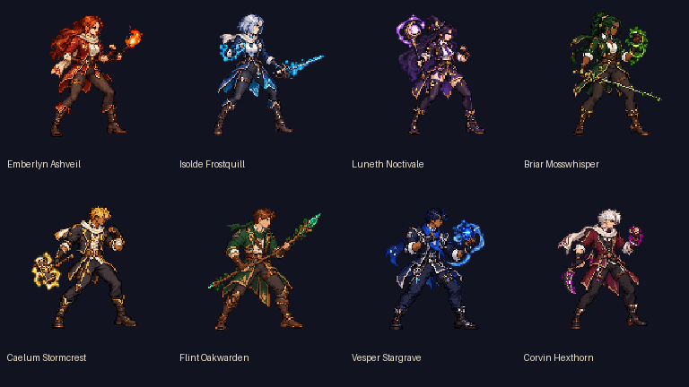
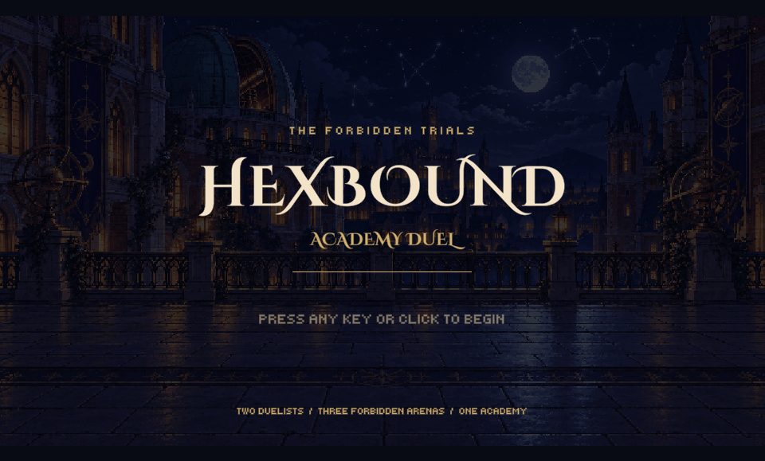
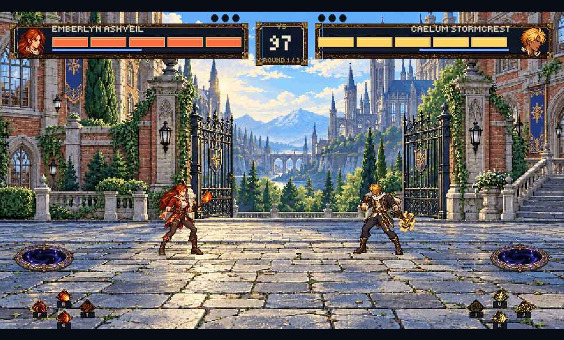
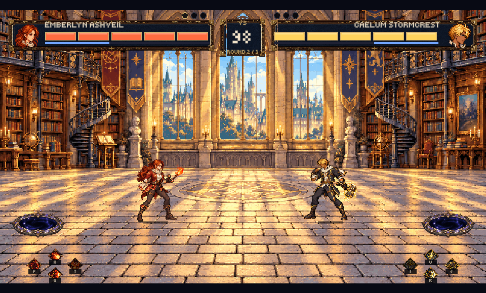
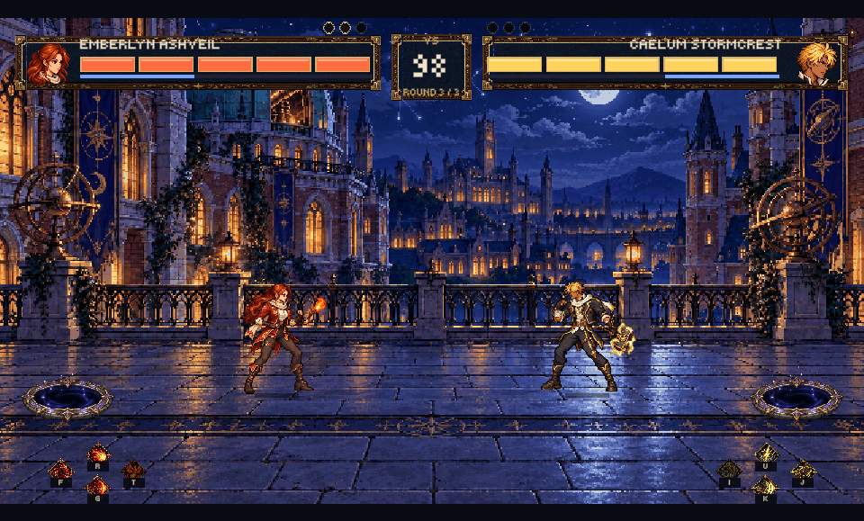
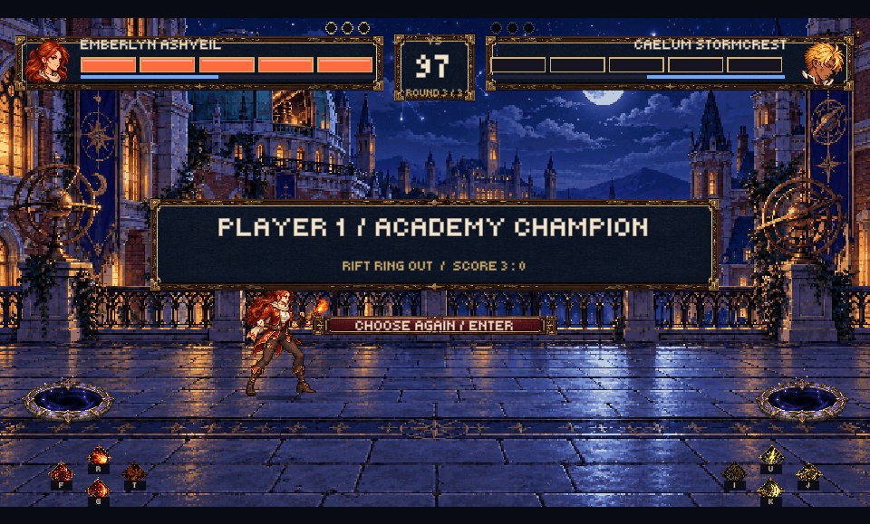
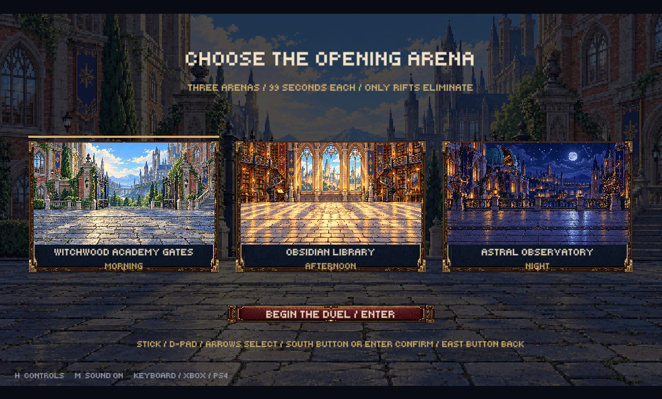
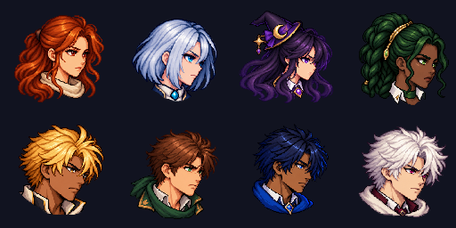
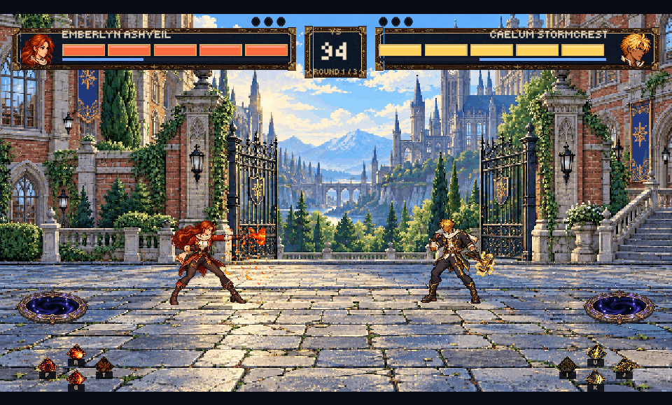
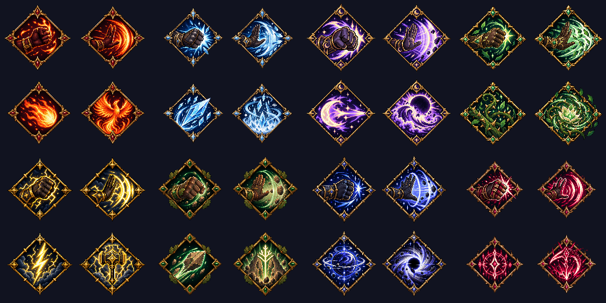

# Validation record

Date: **23 October 2026**, macOS. This is a student prototype with generated academy pixel art and synthesized audio.

The original prototype was verified on **6000.2.2f1**. The currently open user Editor upgraded the project to **6000.3.27f1**; its existing version/package changes are preserved. The current update is validated in an isolated project copy so the open session is not interrupted.

## Passed

| Check | Result | Evidence |
| --- | --- | --- |
| Pure C# combat rules | **63 assertions passed** | `Tools/test_rules.sh`, using installed Unity Mono |
| Unity compile and asset import | **Passed** on **6000.2.2f1** | Batch entry point `Hexbound.Editor.ProjectSetup.ValidateBatch` |
| Character assets | Eight sheets, eight avatars and eight effect sheets loaded | Unity batch validation |
| Audio import | All 16 WAV assets loaded | Unity batch validation |
| Runtime title / selection / fight | **Passed** on **6000.2.2f1** | `Hexbound.Editor.PreviewCapture.Start`, rendered Game view screenshots below |
| Rendered UI inspection | Complete title, both selection panels, eight cards, mirrored HUD and arena visible | Screenshots inspected after capture |

The current rule assertions verify that no health pool exists, punches and combos apply knockback, guarding reduces force, all eight fighters can ring out an opponent with both spells and power attacks, melee and shoves can ring out, all three arenas have both edge traps and a safe center, jumps clear the trap, P2 can push left into it, score is awarded once, and timeouts are draws. They also cover arcana costs, cooldown contact, jumping, round reset and the three-round limit.

The first scene-creation attempt failed because Unity does not allow adding a scene beside an unsaved untitled scene. Setup now handles a clean untitled scene and preserves dirty work by asking the user to save it. The subsequent batch validation passed.

An initial screen-desktop capture produced cropped images because of display scaling. The capture tool now reads the actual rendered Game frame; the committed previews show the whole game view. No desktop captures are included.

## Academy artwork update

Each of eight athletic academy fighters has a separate reference image. The replacement actions are generated one four-frame sequence at a time, with multiple requests running concurrently. Ten actions per fighter produce 80 source sequences and 320 runtime frames. The final assembler preserves transparency, uses nearest-neighbor sampling and aligns the lower silhouette to a consistent baseline. Detailed backgrounds remain visibly pixelated at 640 × 360. Source images and full prompts are saved in the repository. Final assembly and Unity 6000.2.2f1 import validation passed. The rendered title, selection, all three arenas with two edge rifts, and a three-ring-out match result passed the graphical smoke check. All 80 sequences (320 nonempty frames) and eight matching portraits were saved.



## Runtime previews












## Still to verify

- Physical two-person simultaneous keyboard input and key rollover.
- Listening to every sound through the Mac's actual output and checking loop seams/volume.
- A complete human playthrough of all three arenas and several fighter pairings; automated rule checks verify outcomes but do not judge combat feel.
- Other operating systems, standalone builds, physical controller connections, and mobile/touch behavior.

The graphical smoke pass opens the title, selection and all three arenas automatically, then forces one ring-out in each arena and checks the three-win match result. It checks runtime rendering, edge-trap outcomes and match flow; it is not a substitute for manually pressing every input or playing a match.

## Run checks again

From the repository root:

```bash
Tools/test_rules.sh
```

If another editor version supplies Mono, set its bin directory:

```bash
UNITY_MONO="/Applications/Unity/Hub/Editor/6000.2.2f1/Unity.app/Contents/MonoBleedingEdge/bin" Tools/test_rules.sh
```

Unity compilation/import/rule validation (use the path to your installed editor):

```bash
"/Applications/Unity/Hub/Editor/6000.2.2f1/Unity.app/Contents/MacOS/Unity" \
  -batchmode -nographics -quit \
  -projectPath "$PWD" \
  -executeMethod Hexbound.Editor.ProjectSetup.ValidateBatch \
  -logFile /tmp/hexbound-validation.log
```

Success writes `HEXBOUND VALIDATION PASSED: rules and imported assets` to the log and exits successfully. This batch command modifies/imports project settings and may update `ProjectVersion.txt` to the editor actually used.

Optional graphical smoke pass, with the project closed in other Unity processes:

```bash
"/Applications/Unity/Hub/Editor/6000.2.2f1/Unity.app/Contents/MacOS/Unity" \
  -projectPath "$PWD" \
  -executeMethod Hexbound.Editor.PreviewCapture.Start \
  -logFile /tmp/hexbound-preview.log
```

This opens Unity, enters Play mode, updates `Docs/Previews`, then **closes that Unity process automatically**. It requires a graphical desktop session. Normal gameplay uses **Assets/Scenes/Main.unity → Play**, with no automated exit.

## Repository delivery

GitHub CLI is authenticated as Tinenen-cs and the original project history is published to `https://github.com/Tinenen-cs/Fight-Fght.git`. Updates use ordinary commits and pushes to main. No credentials are stored in this repository.

## Menu, portraits and knockdown update

63 pure C# assertions pass, including five-hit knockdown without elimination, blocked controls during knockdown, recovery and hit-count reset, guarded-hit exclusion, rift elimination while down, timeout draws while down, and selected arena rotation. The clean title has no character art. Selection uses two large opposing academy fighters and eight central roster cards. Stage selection previews morning gates, afternoon library, and night observatory.

Main contains a saved native SpriteRenderer preview visible before Play. Its root disables itself during Play; automated capture checks that this happens. The runtime menus remain generated by AcademyGame.





The final 6000.3.27f1 isolated-copy compile/import check passed with all eight authored reaction sheets and large selection images present. The graphical smoke pass also checks that both player locks advance to stage selection. Unity's Editor Search indexer emitted an internal `ArgumentOutOfRangeException` at startup in the isolated copy; game compilation, rule checks and rendered flow continued successfully. Human two-player keyboard and audio checks remain pending.

## Fight HUD and controller input update

- Pure combat checks: **63 passed**, with the threshold updated to five unguarded hits. Five poise segments empty on knockdown and restore on recovery; ring-out-only elimination and timeout draws remain verified.
- Input checks: **16 virtual-device assertions passed** using Input System 1.14.1 in Unity 6000.3.27f1 Play mode. Coverage includes separate gamepad slots, independent keyboard keys, menu navigation, stick deadzone, button press edges, jump/guard/power bindings, confirm/back/pause, disconnect detection, stable surviving slots, replacement controllers, Xbox and PlayStation prompts, and prompt isolation between players. Headless tests explicitly route device events to Play mode and ignore window focus; normal gameplay retains focus-loss pause.
- Physical Xbox and DualShock 4 controllers have not been tested. USB/Bluetooth pairing and macOS device support remain manual checks.

Run the virtual-device checks on a closed test project copy (the command enters Play mode and exits automatically):

```bash
"/Applications/Unity/Hub/Editor/6000.3.27f1/Unity.app/Contents/MacOS/Unity" \
  -batchmode -nographics -projectPath "$PWD" \
  -executeMethod Hexbound.Editor.InputChecks.ValidateBatch \
  -logFile /tmp/hexbound-input-checks.log
```

Do not add `-quit`: this check enters Play mode asynchronously and exits itself after assertions. The editable action asset is `Assets/Resources/Input/AcademyControls.inputactions`; Active Input Handling is Both. Restart Unity after the new package/backend is imported if prompted.



The final graphical smoke passed the complete title/character/stage/three-arena flow and ring-out match result with the mirrored five-segment HUD. A spell created through DuelModel was rendered and captured with visible lower-side controls. Screen previews are inspected for portrait/name alignment, readable meters, effect placement and portal/control separation.

## Final five-bar, diamond, flat-floor and audio changes

All stages now share y=557 as the fighting baseline. Portal rectangles end at y=619; each of eight diamond control rectangles begins at y=624 or lower. Sixteen layout assertions check bounds and both portal overlaps. The afternoon source art has a continuous tiled floor with no raised foreground lip.

Thirty-two dedicated diamond icons are imported from eight independent four-icon generations. Prompts and committed sources are recorded in `Docs/ability_icon_manifest.json`; the flat-floor edit is recorded in `Docs/flat_library_prompt.json`.

The four new stereo scores have unique file hashes, distinct melodies/arrangements, durations between 19.2 and 26.667 seconds, nonzero RMS, peaks below clipping and checked loop boundaries. Twelve new stereo effects are imported. `Docs/audio_manifest.json` records exact metrics and original-composition credits. Graphical smoke checks also assert the playing music clip changes to the next arena. These automated checks do not judge subjective musical quality or replace listening on the Mac.

The simplified combat screen has plain head portraits and no circular head frame, device labels, large control legends, stage banner or rules footer. Only small binding badges remain on diamond icons. Full instructions stay in the handbook.



Final graphical inspection passed with the minimal fight HUD, unframed head portraits, five poise bars, larger diamond icons with key-only badges, unobstructed portals and a flat afternoon floor. The three-stage runtime smoke passed and verified music switching after each arena change.
