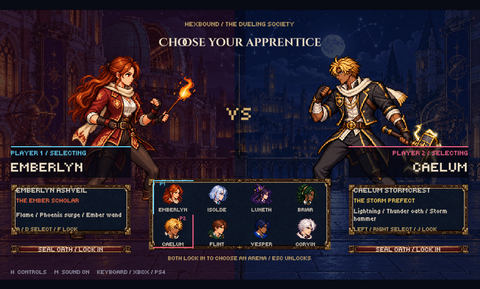

# Hexbound: Academy Duel

A local **two-player, 2D pixel-art magical fighting prototype** made with Unity and edited in VS Code. Four witches and four wizards duel across a haunted forest, an academy library, and an astral observatory. Attack, chain a three-strike combo, cast spells, guard, jump, and shove your opponent into an opening manhole.

The supplied fighting-game screenshots inspire the **UI arrangement only**: opposing character cards, a portrait selection grid, mirrored health bars, and a central timer. All fighter and arena artwork is original procedural pixel art. This is a student prototype with simple sprites and synthesized audio, ready for iteration rather than a finished commercial fighting game.



## Download & play

Repository: **[Tinenen-cs/Fight-Fght](https://github.com/Tinenen-cs/Fight-Fght)**. The first prototype is committed locally; upload is pending GitHub sign-in on this Mac. Open the local project in Unity to test. No standalone application, mobile package, or online multiplayer service is included.

| Device | Output | Status |
| --- | --- | --- |
| macOS | Unity Editor playtest | Compiled, asset-validated and visually smoke-tested with installed 6000.2.2f1 |
| Requested Unity | 6000.3.27f1 | Target version; not installed on this Mac at implementation time |
| Windows / Linux | Editor / future desktop build | Not tested |
| Browser / mobile | Future builds | No touch controls or builds |

## Activity: Two-player academy duel

| Rule | Behavior | Code |
| --- | --- | --- |
| Two players | Shared keyboard, independent character choices; mirror matches allowed | `AcademyGame` |
| Intro → selection → combat | Animated title, eight portrait cards, individual lock-in buttons | `AcademyGame` |
| Basic attacks | Short attack startup, one hit per strike, reach and height checks | `DuelModel` |
| Combo | Tap punch three times about 0.35–0.65 seconds apart; the third strike hits harder | `DuelModel` |
| Spells | Eight profiles with different projectile speeds, damage and knockback | `DuelModel` |
| Power attack | Enhanced spell costs 60 arcana; regular spell costs 20 | `DuelModel` |
| Guard / jump / shove | Reduce damage, clear hazards, push without health damage | `DuelModel` |
| Win a round | Reduce health to zero, force a ring-out, or have more health at timeout | `DuelModel` |
| Three stages | Exactly three rounds, one per arena, including draws; most wins takes match | `DuelModel` |
| Timer | Each round starts with a three-second preparation count, then 99 seconds | `AcademyGame`, `DuelModel` |
| Manhole twist | Opens after 8 seconds; alternates 7 seconds open / 7 closed, with 2-second warning | `DuelModel` |

### Recording a short demonstration

1. Start the title screen, then choose different fighters for both players.
2. Lock in with **F** and **J**. Show the countdown, health bars, arcana meters and timer.
3. Move close, demonstrate punching, a three-hit combo, guarding, and a shove.
4. Cast a spell, then build enough arcana for a power attack.
5. Wait for the manhole warning. Jump over it or push the opponent in while open.
6. Play all three arenas. Press Enter after each result; the final screen names the overall champion or a draw.

## Status

The live task list is [Docs/TODO.md](Docs/TODO.md). Evidence and limitations are in [Docs/VALIDATION.md](Docs/VALIDATION.md).

| Step | Feature | Status |
| --- | --- | --- |
| 1 | Organized Unity project, scene, source and VS Code recommendations | Implemented |
| 2 | Eight fighters, eight avatars, 320 character frames | Included |
| 3 | Per-fighter animated magic sheets: 64 effect frames | Included |
| 4 | Title, two-player selection, combat HUD, pause and results | Implemented |
| 5 | Three arenas and 99-second rounds | Implemented |
| 6 | Combat, combo, spells, power attacks, guard, jump and manhole | Implemented |
| 7 | Four music loops and twelve sound effects | Included and connected |
| 8 | Automated combat checks / Unity import and compile | Passed; see validation notes |
| 9 | Requested 6000.3.27f1 and two-person hardware playtest | Pending |
| 10 | Gamepad, online play, mobile and distributable builds | Outside this first prototype |

## Features

- Original dark-academia art at small source resolutions, enlarged with point filtering.
- Four female and four male magical human characters, each with a signature weapon and power.
- Idle, walk, punch, hurt, knockout, combo, spell, power, shove and jump animation rows.
- Mana regeneration and mana gains on melee contact; stronger attacks require resource management.
- Direction automatically faces the other fighter. Jumping lets fighters pass one another.
- Ambient chiptune loops for selection and each arena; cues for movement, combat, UI, warnings and results.
- Focus loss pauses combat. Escape pauses/resumes, H opens help, and M saves a mute preference.
- No external runtime packages; built-in Unity modules keep initial setup small.

## Characters

| Fighter | Character | Power | Weapon | Power attack |
| --- | --- | --- | --- | --- |
| Lyra | Girl / Ember scholar | Fire | Ember wand | Phoenix surge |
| Mira | Girl / Frost duelist | Ice | Glacier blade | Winter verdict |
| Selene | Girl / Moon archivist | Lunar magic | Lunar staff | Eclipse wave |
| Iris | Girl / Thorn alchemist | Nature | Thorn rapier | Briar bloom |
| Alden | Boy / Storm prefect | Lightning | Storm hammer | Thunder oath |
| Rowan | Boy / Stone warden | Earth | Oak spear | Mountain breaker |
| Orion | Boy / Void astronomer | Gravity | Gravity orb | Event horizon |
| Dorian | Boy / Rune exile | Blood runes | Runic scythe | Crimson seal |

Spell names are thematic: the first prototype distinguishes damage, speed, knockback, color and particle motifs. Ice does not yet freeze, and earth does not create terrain. All fighters share a basic melee moveset.

## Controls

| Action | Player 1 | Player 2 |
| --- | --- | --- |
| Select character | W A S D | Arrow keys |
| Lock choice | F | J |
| Move | A / D | Left / Right |
| Jump | W | Up |
| Guard | S (hold) | Down (hold) |
| Punch / combo | F (tap) | J (tap) |
| Push | G | K |
| Spell: 20 arcana | R | U |
| Power: 60 arcana | T | I |

**Enter:** start / next round / return to selection. **Escape:** unlock choices or pause combat. **H:** help. **M:** mute. Mouse buttons also support menu selection and confirmation. Click cards for P1 first, lock P1, then click cards for P2. Keyboard selections remain independent.

## Project structure

```text
Assets/
  Scenes/Main.unity             saved playable entry scene
  Scripts/Runtime/              game flow, roster, pure C# combat rules
  Scripts/Editor/               setup, pixel import, validation, preview capture
  Resources/Characters/        one folder per fighter: sheet.png + avatar.png
  Resources/Effects/           eight animated power-effect sheets
  Resources/Stages/            three pixel arena backgrounds
  Resources/Audio/Music/       title/select + three arena loops
  Resources/Audio/SFX/         twelve original sound cues
  Resources/UI/                pixel font
  Art/Fonts/                   font license
  Art/UI/                      reserved for future interface artwork
  Animations/                  reserved for future Animator controllers
  Prefabs/                     reserved for future scene-object refactoring
Docs/                          checklist, testing, art guide, design notes
Tools/generate_assets.py       reproducible art and WAV generator
Tools/test_rules.sh            independent combat-rule checks
Packages/                     built-in module manifest / lock
ProjectSettings/              Unity settings
.vscode/                      editor recommendations
```

The prototype uses a pure C# combat model and Unity's immediate-mode GUI to draw a fixed 1280 × 720 playfield. It does not yet use SpriteRenderer prefabs, Animator controllers, Rigidbody2D physics, or UI Toolkit. This keeps the first student version easy to run; the reserved folders support later refactoring. Sprites are animated by selecting cells in their sheets. The scene and import settings are committed with Unity `.meta` files.

## Audio credits

All music and sound effects are original synthesis from `Tools/generate_assets.py`; no commercial songs or recordings are used. Music is intentionally simple chiptune material and can be replaced later. `select`, `confirm`, `punch`, `hit`, `cast`, `power`, `jump`, `step`, `fall`, `win`, `bell`, and `block` cues are connected to game events.

## Art and font credits

Pixel characters, avatars, magic and environments are authored through the included deterministic Python pixel-drawing generator. The supplied screenshots were used only to guide UI placement. No Tekken or Street Fighter characters or assets are included.

Tiny5 comes from [Google Fonts](https://github.com/google/fonts/tree/main/ofl/tiny5), licensed under the SIL Open Font License; see `Assets/Art/Fonts/Tiny5-OFL.txt`. README organization follows the user's [Balance-with-me](https://github.com/Tinenen-cs/Balance-with-me) reference; its game code and artwork were not copied. No repository-wide license has been chosen.

## How to run

### A. Mac — Unity Hub and VS Code

1. Use this existing project folder, or clone:
   ```bash
   git clone https://github.com/Tinenen-cs/Fight-Fght.git
   cd Fight-Fght
   ```
2. In **Unity Hub → Installs**, install/select **6000.3.27f1** if available. Unity versions use `27f1`, not `27.f1`. That requested version is recorded in `ProjectSettings/ProjectVersion.txt`; this Mac's available editor during implementation was **6000.2.2f1**, used for validation. The exact requested version still needs a test.
3. In **Projects → Add project from disk**, choose the root `Fight-Fght` folder containing `Assets`, `Packages`, and `ProjectSettings`.
4. Let Unity finish importing and compiling. Open **Assets → Scenes → Main**, or use **Hexbound → Open Main Scene**.
5. Open the **Game** tab, choose **16:9** (preferably **1280 × 720**), and press **Play**. The title/UI appears during Play.
6. Click inside the Game view. Press **Enter**, choose both characters, and lock in with **F** and **J**.
7. Follow the controls above. Press **Enter** after each round result to continue.
8. Open the same project folder in **VS Code**. Unity is the game editor; VS Code is the code editor, with Codex available to assist. Accept the recommended C# and Unity extensions as needed.
9. Keep the Unity Console open while testing. Stop Play before editing settings or saving scene changes.

### B. Other devices

Desktop source may be opened with Unity, but Windows/Linux and standalone builds have not been tested. Browser, Android, iOS, touch controls and controllers are not part of this prototype. Use the Mac Unity Editor first.

## Troubleshooting

- **Version mismatch:** choose your installed Unity 6 version in Hub; requested-version validation remains pending until 6000.3.27f1 is installed and tested. Keep version changes in source control.
- **Empty scene / no UI before Play:** open Main and press Play. The runtime UI is intentionally generated when the game runs.
- **Keys do nothing:** click the Game view. Escape resumes after focus loss. Under Project Settings → Player, keep Active Input Handling on **Input Manager (Old)** or **Both**; this project uses `UnityEngine.Input`.
- **Too many simultaneous keys:** some keyboards cannot register both players' held keys. Try a second USB keyboard or release guard before attacking; physical keyboard testing is pending.
- **No sound:** press M, disable the Game view mute toggle, and check macOS output volume.
- **Spell does not start:** regular spells require 20 arcana, power attacks 60. Wait for regeneration or land melee hits.
- **Punch misses:** move closer and be at a similar height. Combo taps must be separated by the attack cooldown.
- **Drain loss:** do not stand on the manhole while open. Jumping clears it; guarding reduces shove force.
- **Scene generation warns about unsaved work:** save your untitled scene, then use Hexbound → Open Main Scene.

## Contributing

1. Check [Docs/TODO.md](Docs/TODO.md) and make one focused improvement.
2. Edit files in this repository; keep generated assets and their `.meta` files together.
3. Run combat checks and a Unity playtest. Record actual results in `Docs/VALIDATION.md`.
4. Commit and push the changes:
   ```bash
   git add Assets Docs Tools Packages ProjectSettings README.md .gitignore .vscode
   git commit -m "Describe the game change"
   git push origin main
   ```

Do not commit Unity caches, credentials, local logs, or generated application builds. To regenerate artwork and audio, run `python3 Tools/generate_assets.py` and let Unity reimport. See [Docs/ASSET_GUIDE.md](Docs/ASSET_GUIDE.md) before changing sheet dimensions.
